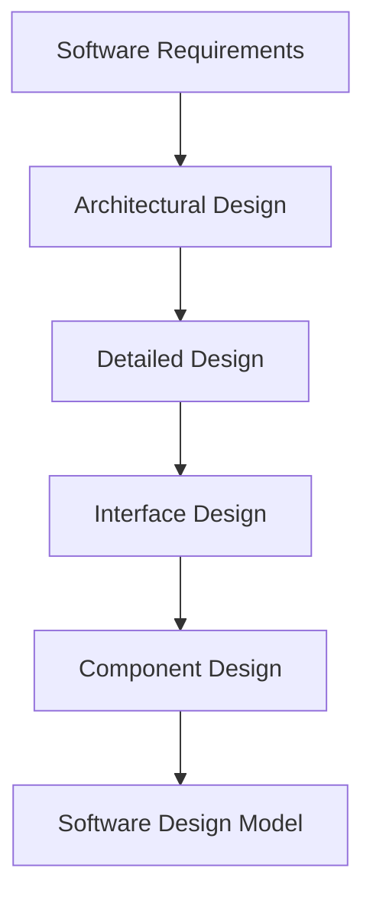
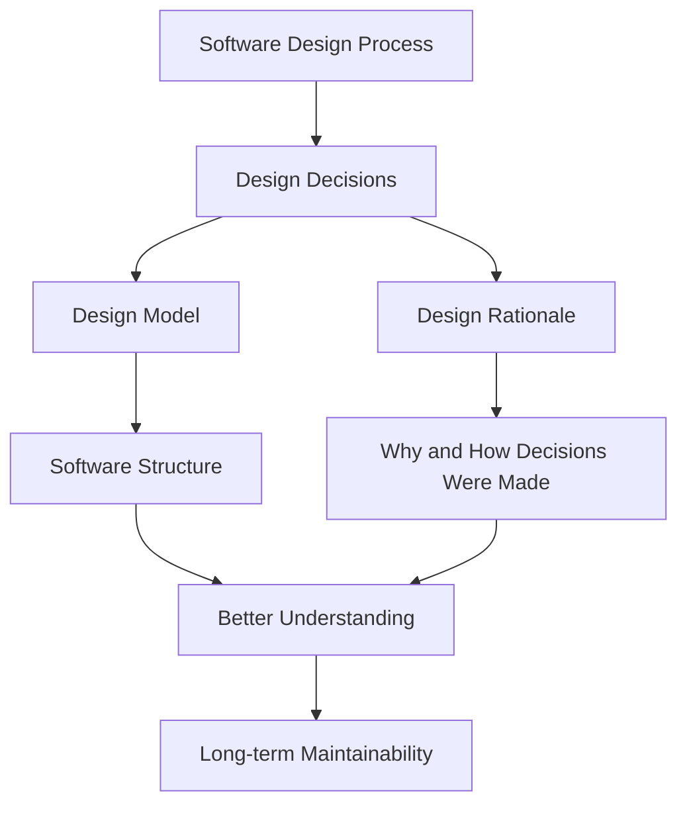
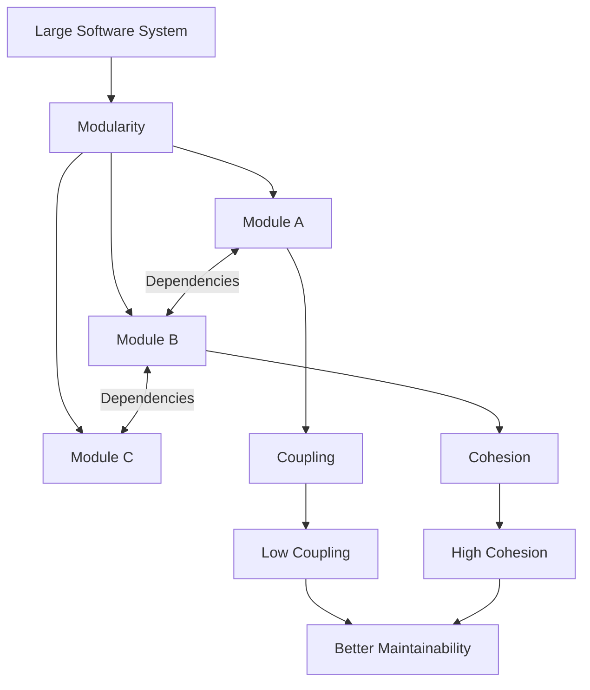
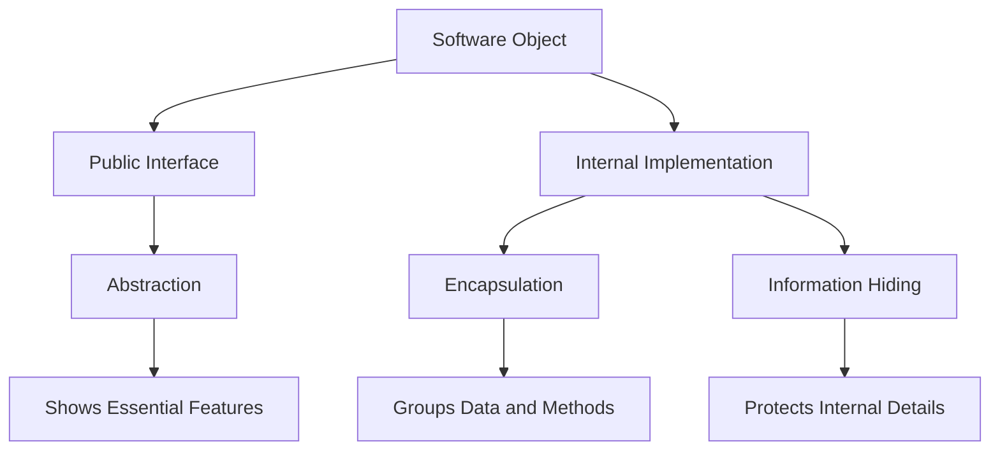
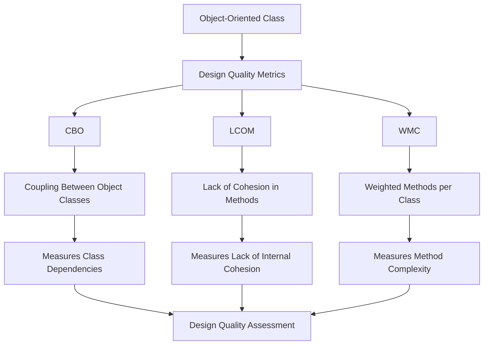
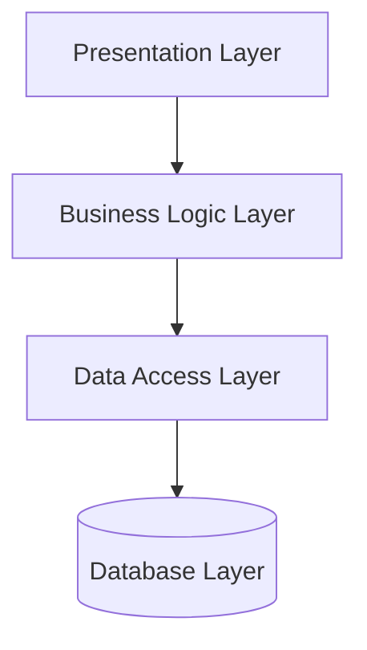
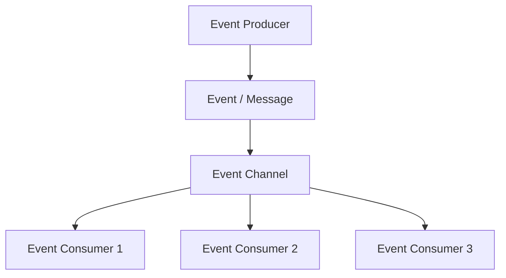
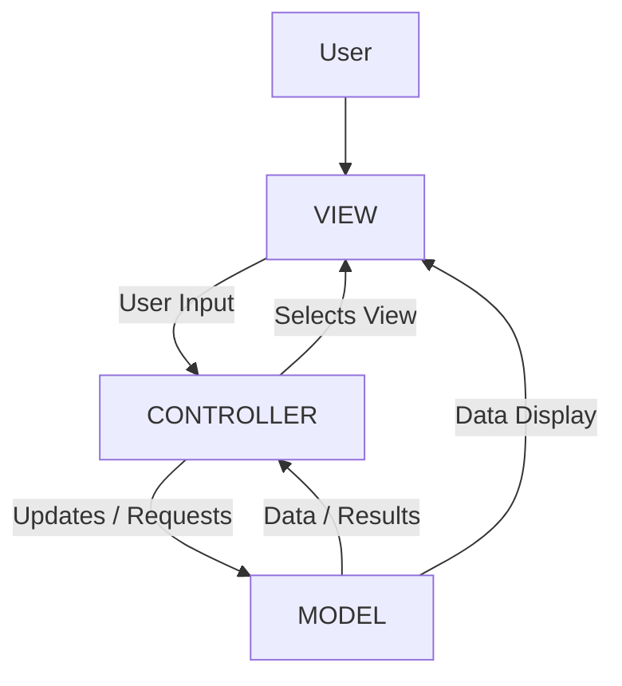
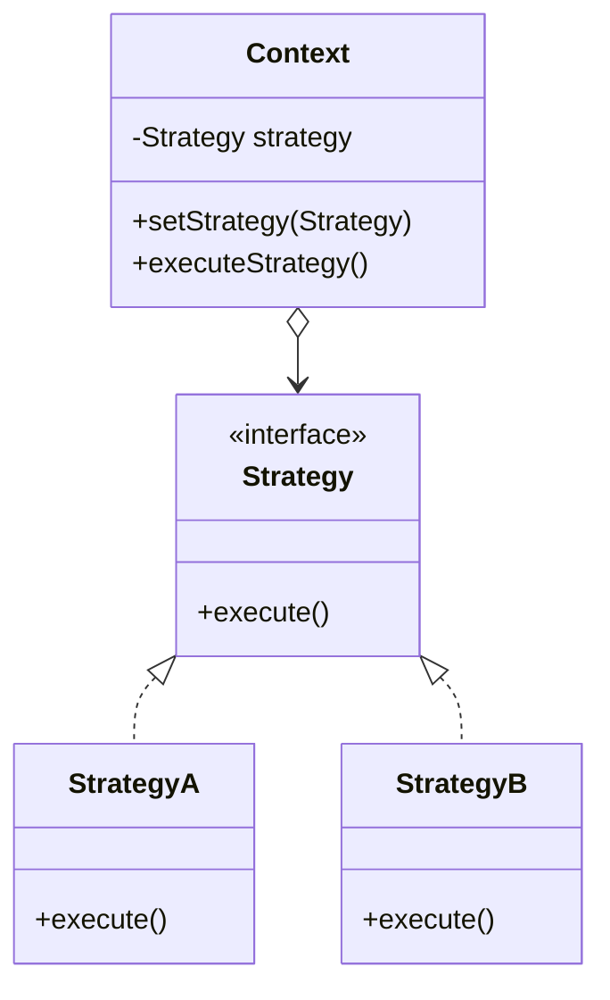
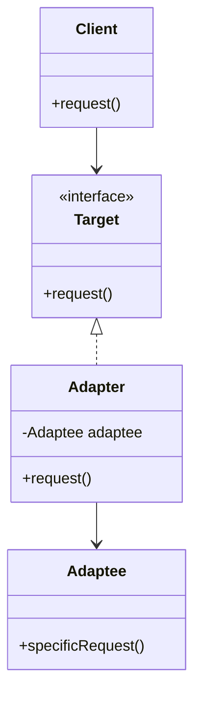

# Software Engineering – Diagrams for OBE Question Set

These diagrams correspond to the eight questions in the Software Engineering question set.
GitHub renders Mermaid diagrams automatically when this Markdown file is viewed in a repository.

## Q1. Software Design Process
**Bloom's Level:** Remember + Understand | **BNQF Domain:** Cognitive | **CO:** CO1 | **Marks:** 4

## Q2. Design Process Outcome and Design Rationale
**Bloom's Level:** Understand | **BNQF Domain:** Cognitive | **CO:** CO1 | **Marks:** 4

## Q3. Modularity, Coupling and Cohesion
**Bloom's Level:** Remember | **BNQF Domain:** Cognitive | **CO:** CO2 | **Marks:** 4

## Q4. Abstraction, Encapsulation and Information Hiding
**Bloom's Level:** Understand | **BNQF Domain:** Cognitive | **CO:** CO2 | **Marks:** 4

## Q5. CBO, LCOM and WMC Metrics
**Bloom's Level:** Understand | **BNQF Domain:** Cognitive | **CO:** CO3 | **Marks:** 8

## Q6. Layered and Event-Based Architecture
**Bloom's Level:** Remember + Understand | **BNQF Domain:** Cognitive | **CO:** CO4 | **Marks:** 4

### A. Layered Architecture

### B. Event-Based Architecture

## Q7. Model–View–Controller (MVC) Architecture
**Bloom's Level:** Understand | **BNQF Domain:** Cognitive | **CO:** CO4 | **Marks:** 4

## Q8. Strategy and Adapter Design Patterns
**Bloom's Level:** Understand | **BNQF Domain:** Cognitive | **CO:** CO5 | **Marks:** 8

### A. Strategy Design Pattern

### B. Adapter Design Pattern

## Infographic

## Question-to-Diagram Checklist

| Question | Diagram(s) | Marks |
|---|---|---:|
| Q1 | Software Design Process | 4 |
| Q2 | Design Outcome and Rationale | 4 |
| Q3 | Modularity, Coupling and Cohesion | 4 |
| Q4 | Abstraction, Encapsulation and Information Hiding | 4 |
| Q5 | CBO, LCOM and WMC | 8 |
| Q6 | Layered and Event-Based Architecture | 4 |
| Q7 | MVC Architecture | 4 |
| Q8 | Strategy and Adapter Patterns | 8 |
| **Total** | **8 Questions** | **40** |
